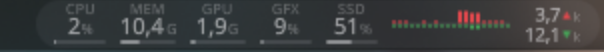

# Capsule System Monitor

A compact system monitor for the Cinnamon panel and the [Omarchy](https://omarchy.org/) bar.
One dark capsule shows memory, CPU, video memory, disk and network at a glance — quiet when
everything is fine, orange when something needs attention.


Running Omarchy (Hyprland)? Jump to [Omarchy](#omarchy) — the same capsule, as an Omarchy
shell plugin.

## Why another system monitor

Two things it does differently.

**The panel never jumps.** Every value lives in a fixed-width slot, so `7%` and `100%` take up
exactly the same space. Most panel monitors reflow every second as the numbers change, which
nudges your clock left and right all day. This one does not: the capsule only changes width
when *you* change the settings.

**At rest it disappears.** Labels sit at 30% white, values at 62%, on a barely-there capsule.
You are not meant to notice it while the machine is idle. When a threshold is crossed, the
value, its bar and the capsule background all turn orange — a single accent colour with a
single meaning: *look here*.

## What it shows

| | |
|---|---|
| **MEM** | system memory, real usage (`used − cached − buffers`) |
| **CPU** | processor load, `iowait` counted as idle |
| **GPU** | NVIDIA video memory (VRAM) |
| **SSD** | disk usage of a mount point you choose |
| **NET** | network throughput as a two-way graph with upload and download speeds |
| **SWP** | swap usage |
| **GFX** | NVIDIA GPU utilisation |
| **TMP** | CPU package temperature |

All eight are optional and reorderable. Five are on by default; the rest are one click away in
the settings.

The network cell is a 20-second history with a centre line: one direction above, the other
below, with the current speed printed at the end of each. **Each direction is scaled against
its own recent peak**, so an upload is fully visible even while a much larger download is
running — a shared scale would flatten it to a stub. Below half a megabyte per second nothing
is magnified, because that is either idle noise or the acknowledgement traffic the opposite
direction generates. The exact magnitude is in the two numbers; the graph is there for the
shape. Only physical interfaces are counted — bridges, `veth` pairs and VPN tunnels are
skipped, so container traffic is not counted two or three times.

## Requirements

- Cinnamon 6.0 or newer (developed on 6.6)
- `libgtop` with GObject introspection — this is the only hard dependency:
  ```
  sudo apt install gir1.2-gtop-2.0     # Linux Mint, Ubuntu, Debian
  sudo dnf install libgtop2            # Fedora
  ```
- `nvidia-smi` for the GPU and GFX elements. Optional: without it those two elements simply
  show `—` and never raise an alert. AMD and Intel GPUs are not read.

## Install

```bash
git clone https://github.com/gaborkis11/capsule-monitor.git
cd capsule-monitor
./install.sh
```

Then right-click the panel → **Applets** → find **Capsule System Monitor** → **+**.

That is all. Once it is on the panel, Cinnamon starts it with every session; there is no
service to enable and nothing to add to your autostart.

To update, pull and run `./install.sh` again, then reload the applet (or log out and back in).

### Manual install

An applet is just a directory. Copy `files/capsule-monitor@gaborkis11` into
`~/.local/share/cinnamon/applets/` and it will show up in the Applets list.

## Settings

Right-click the applet → **Configure**.

- **Elements** — a list with the eight metrics. Click a checkbox to show or hide one, use the
  arrow buttons to change the order they appear in.
- **Appearance** — labels on or off (off makes the bars thicker), and an optional fixed width
  so the applet reserves the same space no matter what is enabled.
- **Display** — memory, swap, video memory and disk can show either the percentage used or the
  **amount used** (`12,8 G`, `468 G`, `1,5 T`). The bar underneath always shows the percentage,
  so switching to gigabytes makes the number more informative without losing the proportion.
  Alert thresholds are evaluated on the percentage in both modes.
- **Network** — the two colours of the graph. The defaults are red for one direction and green
  for the other; if red sits too close to the orange alert colour for your taste, change it
  here without touching any code.
- **Click** — which system monitor the left click opens. Defaults to `gnome-system-monitor`.
- **Disk** — which mount point the SSD element watches. Defaults to `/`.
- **Alert thresholds** — per element. Memory 85%, disk 80%, CPU 90%, video memory 90%.
  The CPU and temperature thresholds only fire when the value stays above the line for a
  sustained period (10 seconds by default), because a processor spikes to 100% many times a
  day and a monitor that cries wolf gets ignored.
- **Refresh** — how often the fast metrics and the GPU are sampled. `nvidia-smi` spawns a
  process and takes 50–150 ms, so it runs on its own slower timer.

## Uninstall

```bash
rm -rf ~/.local/share/cinnamon/applets/capsule-monitor@gaborkis11
```

Remove it from the panel first (right-click the applet → Remove).

## Omarchy



The `omarchy/` directory holds the same monitor as an Omarchy shell plugin (a bar widget
written in QML). It follows the same rules as the Cinnamon applet: fixed-width slots, one
orange accent, sustained CPU and temperature alerts, per-direction network scaling, physical
interfaces only. On the 26 px Omarchy bar the capsule is slightly shorter and the type one pixel
smaller than on a Cinnamon panel.

### Requirements

- Omarchy with the Quickshell-based `omarchy-shell`
- `python3` — the data sampler is a small script that reads `/proc` and `/sys`; no extra
  packages
- `nvidia-smi` for GPU and GFX on NVIDIA. Without it the sampler falls back to the `amdgpu`
  sysfs counters; with neither, those elements show `—`.

### Install

```bash
git clone https://github.com/gaborkis11/capsule-monitor.git
cd capsule-monitor
./omarchy/install.sh
```

The installer copies the plugin to `~/.config/omarchy/plugins/capsule-monitor` and places it
to the left of the clock. Drag it anywhere on the bar to move it. To update, pull and run the
installer again — it restarts the shell so the new version is loaded.

### Settings

Settings go in the widget's entry in `~/.config/omarchy/shell.json`; the bar picks up a saved
change at once. Every key is optional:

```json
{
  "id": "gaborkis.capsule-monitor",
  "elements": ["cpu", "mem", "gpu", "gfx", "ssd", "net"],
  "modes": { "mem": "abs", "gpu": "abs" },
  "thresholds": { "mem": 85, "cpu": 90, "gpu": 90, "ssd": 80, "swp": 50, "gfx": 100, "tmp": 85 },
  "showLabels": true,
  "diskMount": "/",
  "sustainSeconds": 10,
  "clickCommand": "omarchy-launch-or-focus-tui btop"
}
```

| Key | Default | Meaning |
|---|---|---|
| `elements` | `["mem","cpu","gpu","ssd","net"]` | Which elements are shown, in this order. Also available: `swp`, `gfx`, `tmp`. |
| `modes` | all `"pct"` | `"abs"` shows the used amount (`12,8 G`) instead of the percentage for `mem`, `swp`, `gpu`, `ssd`. |
| `thresholds` | see above | Alert threshold per element. A percentage threshold of 100 or more never fires. |
| `showLabels` | `true` | Captions above the values; off makes the bars thicker. |
| `diskMount` | `"/"` | Mount point the SSD element watches. |
| `sustainSeconds` | `10` | How long CPU and temperature must stay above the line before alerting. `0` alerts at once. |
| `clickCommand` | `omarchy-launch-or-focus-tui btop` | What a left click runs. |
| `netColorUp` / `netColorDown` | `#E5484D` / `#46A758` | Colours of the network graph and arrows. |
| `alertColor` | `#FF8C00` | The single accent colour. |
| `fixedWidth` | `0` | Reserve a fixed width in pixels; `0` sizes the capsule to its elements. |
| `refreshMs` / `gpuRefreshMs` | `1000` / `5000` | Sampling intervals. |
| `fontFamily` | `"Noto Sans"` | Font of the capsule; tabular figures keep the digits still. |

Hovering the capsule shows the detailed tooltip, including every fixed volume.

### Uninstall

```bash
omarchy plugin disable gaborkis.capsule-monitor
rm -rf ~/.config/omarchy/plugins/capsule-monitor
```

## Licence

GPL-3.0. See [LICENSE](LICENSE).
